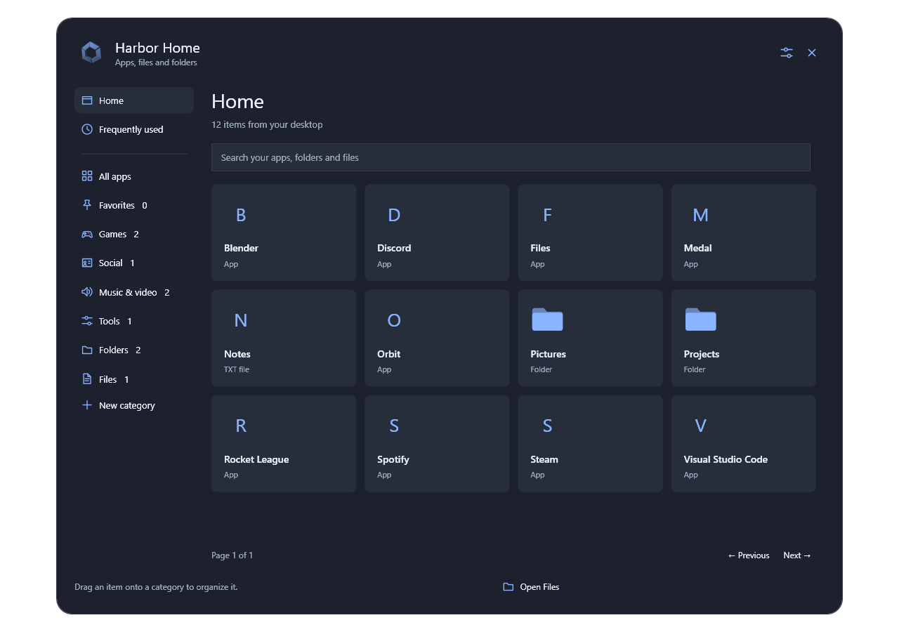
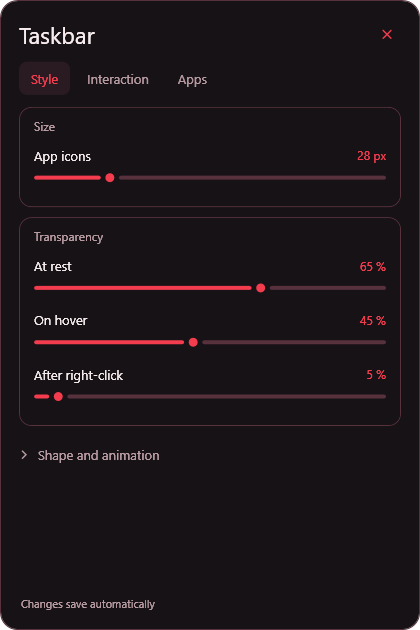

# HarborLauncher

**Harbor 0.14.2** is a customizable Windows desktop shell with its own Home library, desktop, taskbar, top Dock, file manager, notifications and native plugin engine.

[Browse mods](https://harbor-mods.orangemole11.chatgpt.site) · [Report an issue](https://github.com/0rampagethefirst0/HarborLauncher/issues)



## Try Harbor

The source is published here; a prebuilt download has not been published.

1. Install the **.NET 9 SDK, x64**, from [Microsoft](https://dotnet.microsoft.com/en-us/download/dotnet/9.0).
2. Clone this repository or choose **Code > Download ZIP**, then extract the source.
3. From the project folder, run `powershell -NoProfile -ExecutionPolicy Bypass -File .\build.ps1 -Install`.
4. Run `App\Harbor.exe`. Choose your features in **Mods > Features**. Optional plugins start disabled on a new profile.
5. For sign-in replacement, enable **Use Harbor as my desktop when I sign in** in Settings. Keep the installation in that folder while enabled.

Harbor is an early preview for Windows 10/11 x64. Shell mode replaces Explorer's desktop and bars while retaining Windows for recovery. Security/sign-in screens, app dialogs, Windows toast popups and advanced system settings remain Windows or app surfaces.

**Recovery:** press **Ctrl+Alt+F12** to exit and return to Windows. Run **Restore Windows.cmd** to undo Harbor's sign-in shell and folder-open registration. Original values are backed up before activation; a separate supervisor handles crashes. See [setup and recovery](INSTALL.md).

## Customize your desktop

- **Home:** a central animated 3D emblem opens a categorized library. Customize favorites, frequent apps, categories, tabs, sizing and layout. The Recycle Bin remains above the emblem.
- **Taskbar and Dock:** rearrange pieces and dividers, create app folders, tune transparency and click-through behavior. The top bar is **Minimalists Dock**; taskbar folders are **Bulky**.
- **Files:** tabs, app folders, tree navigation, grid/details, previews, clipboard, drag/drop, shell operations, search, archives, batch rename, native context menus and Recycle Bin restore. [Details](FILES.md).
- **Tools:** compact controls expand from edges or snap points. Combine readings, choose drives, change time formats and show tools only with Apps or chosen applications.
- **Themes:** customize surfaces, text, borders, wallpaper, logo and fire. Tokyo Dragon adds a red outline theme, an extruded dragon head and a flame-to-Home transition.
- **Mods:** 57 bundled packages with recorded demonstrations and usage guides. Build native layouts and behavior rules, export `.harbormod` files and share through the public community. [Plugin format](MODS.md) · [Behavior modules](BEHAVIOR.md).

Harbor uses WPF software rendering and does not inject into games. Game hiding applies to the focused game's monitor, preserving Harbor on other monitors. Live motion targets 120 FPS; recorded previews contain 288 frames at 90 FPS. Actual performance depends on the PC and display. Windhawk DLLs and `.wh.cpp` packages are not compatible with Harbor's native package format.



## Shortcuts

| Keys | Action |
| --- | --- |
| Windows / Ctrl+Esc / Ctrl+Alt+Space | Apps |
| Win+E | Files |
| Win+N / Win+A | Notifications / quick settings |
| Win+D | Show or restore desktop |
| Print Screen / Win+Shift+S | Capture an area |
| Win+Print Screen / Alt+Print Screen | Capture monitors / focused window |
| Ctrl+Alt+F12 | Exit and recover Windows desktop |

Captures go to the clipboard and Pictures\Screenshots. Preferences, plugins and logs stay in `%LOCALAPPDATA%\Harbor`. Frequent-app activity stays local and is omitted from exported profiles.

## Build

Install the **.NET 9 SDK** on Windows:

```powershell
powershell -NoProfile -ExecutionPolicy Bypass -File .\build.ps1 -BuildOnly
```

This stages Harbor and the supervisor in a timestamped `Build` folder without restarting the desktop. Omit `-BuildOnly` to update local `App` and `Session` folders; add `-Install` for shortcuts.

Native checks use isolated test profiles:

```powershell
Start-Process .\App\Harbor.exe -ArgumentList '--verify checks\fresh-native' -Wait
Start-Process .\App\Harbor.exe -ArgumentList '--verify-scroll checks\fresh-scroll' -Wait
```

Use a new output directory each time. See [development notes](DEVELOPMENT.md) and [release notes](CHANGELOG.md). `Community` contains the web catalog source. Screenshots are offscreen previews, not a user's desktop captures.
