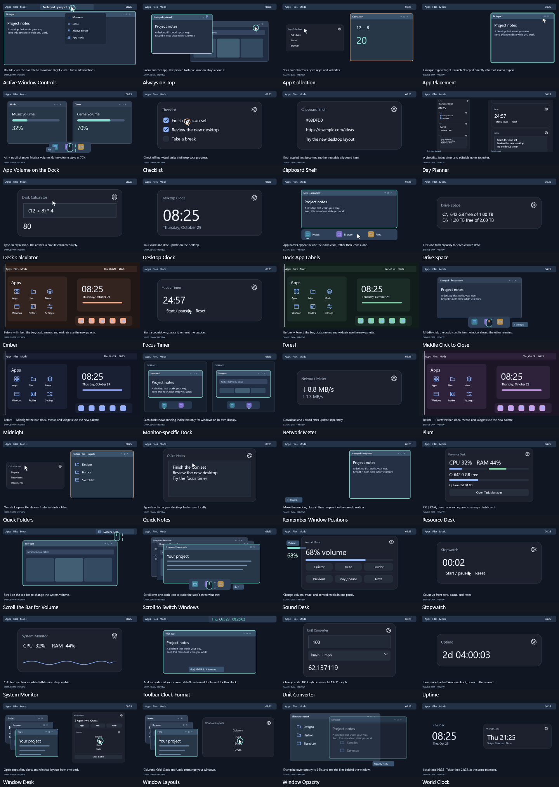

# Harbor 0.5.1

A native Windows shell with a desktop, top bar, dock, Apps screen, file manager, notification center, settings, and native mods. Run **App\Harbor.exe** or the Harbor shortcut. Requires .NET 9 Windows Desktop Runtime x64.

- **Windows**, **Ctrl + Esc**, or **Ctrl + Alt + Space** opens apps. Focusing another app closes the Apps screen.
- **Win + E** opens Harbor Files; **Win + N** opens notifications; **Win + A** opens quick settings; **Win + D** shows/restores the desktop.
- **Ctrl + Alt + F12** exits and restores Windows. **Restore Windows.cmd** provides another recovery route.
- Right-click dock apps to pin, move, switch, close, or choose **Treat as game**. Drop an `.exe`, `.lnk`, or `.url` to pin it.
- Open **Mods** from the top bar or settings. Install/enable a package, edit its options, and choose **Apply settings**. Drag widgets by their headers. **Create a mod** makes an independent package from the selected mod and its settings; **Export** shares it as a `.harbormod` file.
- In Settings, choose **Customize colors, bars, and layout** to change colors, bar sizes, dock alignment, icon size, and top-bar controls. Themes can override the base palette.
- Select a mod and choose **Open visual builder** to compose rows, text, meters, buttons, saved inputs, checkboxes, and existing widgets. Edit the live preview, save a new package, or export it.
- **Hover-through dock:** when an app is behind the dock, hovering fades the dock and passes clicks to that app. The first right-click only activates the dock; another right-click opens its normal app menu. It stays interactive while you use it and for three seconds after leaving. Typing in an app returns that monitor's dock to faded, click-through mode until a short pause. Appearance controls the fade, delay, and switch back to reserved screen space. App menus include **Close windows** and **End task** for supported apps.
- **Behavior mods** change window, dock, toolbar, and audio behavior. Right-click a dock app and choose **Mods for this app** to create a targeted rule. See [BEHAVIOR.md](BEHAVIOR.md).
- **Profiles** save appearance, enabled mods, declared mod options, and widget positions. Switch profiles, export/import `.harborprofile` files, or undo the last switch. Pins, startup, notes, clipboard, and remembered app positions stay independent.
- Click the small **up-chevron at the dock's center** for a sliding six-setting box: click-through, typing mode, faded opacity, active time, icon size, and motion duration. Changes save automatically. Brief fades and icon lifts use software rendering; setting motion to zero disables them.
- Menus use native vector icons and dark rounded surfaces. Dock controls has matching icons, switches, and circular slider handles; the default white menu gutter and control boxes are replaced.

The dock now keeps each app button in place while window titles, focus, and running apps change. Packaged apps use their own Windows app identity instead of sharing a generic host-process group. Dock overflow scrolls with the mouse wheel, and **Show desktop** is available beside the layout control.

Harbor hides its bars only on the focused game's monitor, including windowed games. Other monitors keep Harbor visible. Hidden bars release their screen space, and cut-off game windows are fitted within the monitor without changing fullscreen mode. Override automatic detection with **Treat as game**. Native taskbar reappearance is handled immediately, and work-area changes avoid the broadcast that previously made taskbars alternate.

Harbor clears an inherited `ELECTRON_RUN_AS_NODE` flag before launching desktop apps. This fixes Medal silently exiting when Harbor was started by a development host. The system environment is unchanged.

Mods now has three main categories: **Desktop**, **Themes**, and **Tools**, each with subcategories. Choose a category for an animated showcase with white slide dots, previous/next controls, and a right arrow into its full collection. Cards have individual recorded demonstrations or a creator-supplied banner, tags, and a single **Install / Uninstall** button. Install enables the package immediately; uninstall keeps its saved settings. Details include settings, pause/resume, favorites, dependency/conflict information, and the visual builder.

**Create a plugin** starts from a working native capability. Choose one required main category and subcategory, select optional tags from 65 suggestions or enter your own, set a version, and attach a PNG/JPEG banner. Use **Upload to community** to prepare an export and open the public creator page; it copies the export path for the browser file picker. Sign in, choose the file, review it, and publish. Creator accounts can update and remove their own packages. Harbor fetches the community catalog when Mods opens and through its refresh button; downloaded definitions remain inactive until installed.

The [public Harbor Mods community](https://harbor-mods.orangemole11.chatgpt.site) includes a persistent upload service. The shipped library still contains **36 real packages**: 16 native widgets, four themes, four composed dashboards, and 12 behavior mods. The requested 1,000+ distinct mod library needs more actual plugins; the 1,200 scale-test entries remain isolated test fixtures. See [MODS.md](MODS.md) and [DEVELOPMENT.md](DEVELOPMENT.md).

Harbor combines a desktop shell with configurable behavior modules. Its packages run through Harbor's native engine. Windhawk `.wh.cpp` packages are not compatible with Harbor's package format.

Harbor Files supports navigation, folder search, new folders, rename, copy, cut/paste, and recycling. The notification center reads available Windows toast history without modifying the database; dismissing affects Harbor's view. Windows toast popups, advanced OS settings, app-owned dialogs, sign-in, and security screens remain Windows/app-owned. Quick settings temporarily reveals the native system tray while Harbor's tray is developed.

WPF software rendering is requested before creating windows and on each render target. Panels are solid; wallpaper is static. The desktop shell has no browser renderer, blur, or live wallpaper. Motion uses short native UI transitions and the active category slideshow; it stops while the catalog is inactive and respects the motion-off setting. Windows still uses its compositor.

A separate watchdog restores taskbars, desktop icons, and saved monitor working areas after exit, failure, or an unresponsive UI. Its 20-second timeout excludes sleep/hibernation. Recovery-state writes tolerate temporary file locks and retry on the next heartbeat. Explorer remains running to host the desktop and system services. Preferences, notes, mods, and logs live in `%LOCALAPPDATA%\Harbor`.

Build with `powershell -ExecutionPolicy Bypass -File .\build.ps1`; add `-Install` for shortcuts. A successful build is staged before the live shell is restarted. Use `-BuildOnly` to stage a build without restarting Harbor. Source is included under `src`.

- `Harbor.exe --verify <directory>` runs isolated package, widget, settings, file-operation, and game-rule checks.
- `Harbor.exe --render-check <directory>` renders 16 offscreen previews without changing the desktop.
- `Harbor.exe --status --output <file>` writes runtime status.
- `--files`, `--mods`, `--notifications`, `--settings`, `--appearance`, `--profiles`, `--dock-controls`, and `--launcher` open the corresponding surfaces.

To remove Harbor, exit it, disable **Start Harbor when I sign in**, and remove its shortcuts/project folder. Release ZIPs exclude personal settings and screenshots.

In 0.5.1 all 36 bundled packages have their own demonstration: the 20 widgets/dashboards use the actual native controls with deterministic sample data, the four themes show the whole shell palette changing, and each of the 12 behavior mods has its own staged desktop example. Hover a banner to play it; the featured/detail preview starts automatically. Only one preview plays at once, playback stops when the catalog loses focus, and motion zero keeps posters static. Example windows and values are labeled as previews; they do not manipulate your real apps, clipboard, audio or saved data.

## Preview gallery

See [Harbor Mods](https://harbor-mods.orangemole11.chatgpt.site) for animated demonstrations and community uploads. The videos use sample data and staged desktop examples.

To build on another PC, install the .NET 9 SDK with Windows desktop support, then run `powershell -File .\build.ps1`. The current desktop executable also needs the .NET 9 Windows Desktop runtime. Use `Ctrl+Alt+F12` or `Restore Windows.cmd` to restore Windows.
